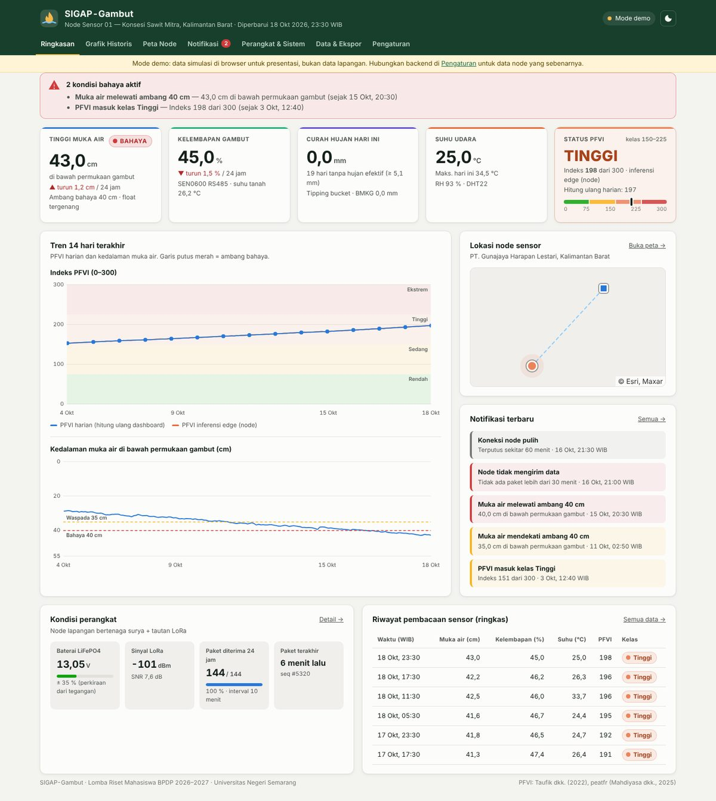

# SIGAP-Gambut — Dashboard Monitoring IoT

Dashboard web untuk **SIGAP-Gambut: Sistem Prediksi Risiko Kebakaran Lahan Gambut Real-Time Berbasis
Peat Fire Vulnerability Index (PFVI) dan Sensor IoT pada Konsesi Kelapa Sawit**
(Lomba Riset Mahasiswa BPDP 2026–2027, Universitas Negeri Semarang).

Dashboard ini adalah blok ke-5 kerangka IoT pada proposal: menampilkan pembacaan node sensor
(muka air, kelembapan gambut, curah hujan, suhu), status dan tren PFVI dalam empat kelas risiko,
lokasi node di peta, notifikasi ambang bahaya, kondisi perangkat (baterai PV, sinyal LoRa), serta
ekspor data, termasuk format masukan paket R [peatfr](https://github.com/mellygsln/peatfr) untuk kalibrasi.



## Fitur

| Halaman | Isi |
|---|---|
| **Ringkasan** | 4 variabel sensor + status PFVI, banner kondisi bahaya, tren 14 hari (PFVI & muka air dengan ambang 35/40 cm), peta mini, notifikasi terbaru, kondisi perangkat, riwayat ringkas |
| **Grafik historis** | 24 jam / 7 hari / 30 hari: muka air, PFVI (edge vs hitung ulang vs DIobs), kelembapan, hujan (tipping bucket vs BMKG), suhu udara & tanah, RH, baterai, RSSI |
| **Peta node** | Citra satelit / OSM, warna node sesuai kelas PFVI, tautan LoRa ke penerima beserta jarak |
| **Notifikasi** | Log peristiwa + kondisi aktif; muka air, PFVI, kelembapan, float switch, baterai, node offline, sinyal lemah; notifikasi browser |
| **Perangkat & sistem** | Baterai & SoC, paket diterima (24 jam / 7 hari), arsitektur 5 blok, rumus dan komponen PFVI harian (DF, RF, WTF) |
| **Data & ekspor** | Tabel agregat harian + pembacaan mentah; unduh CSV, CSV harian + PFVI, CSV format peatfr, JSON |
| **Pengaturan** | Sumber data (API, MQTT WebSocket), koordinat node & penerima, ambang notifikasi, parameter PFVI |

Mendukung mode terang/gelap dan tampilan ponsel. Semua pustaka (Chart.js, Leaflet, mqtt.js) disertakan
di repo, jadi dashboard tetap jalan tanpa CDN; hanya tile peta yang butuh internet.

## Tiga mode data

1. **Demo**: data simulasi 30 hari dibuat di browser (skenario akhir kemarau: muka air turun ±1,1 cm/hari,
   PFVI naik ke kelas Tinggi). Dipakai otomatis bila backend tidak ditemukan, misalnya di GitHub Pages.
   Ada pita kuning "Mode demo" agar tidak tertukar dengan data lapangan.
2. **Live via API**: dashboard disajikan oleh backend (`server/app.py`), mengambil riwayat dan memeriksa
   paket baru tiap 60 detik.
3. **Live via MQTT WebSocket**: seperti nomor 2, ditambah pembaruan instan langsung dari broker.

## Arsitektur

```
Node lapangan (TTGO LoRa32, PV 50 Wp)                 Gedung                         VPS / PC lokal
 hydrostatic · float · SEN0600 · DHT22 ──LoRa──▶ TTGO LoRa32 penerima ──MQTT──▶ Mosquitto ──▶ FastAPI ──▶ SQLite
 tipping bucket · tegangan baterai     ~20 byte   + WiFi / router 4G                    │            │
 inferensi PFVI (TinyML)               /10 menit                                        └─ws──▶ Dashboard ◀┘
```

Format paket radio, topik MQTT, payload JSON, dan endpoint API ada di **[docs/kontrak-data.md](docs/kontrak-data.md)**.
Pegangan ini untuk menulis firmware node dan penerima.

## Struktur repo

```
web/                    dashboard statis (HTML + CSS + JS modul, tanpa build)
  assets/js/config.js   konfigurasi bawaan: lokasi, node, ambang, parameter PFVI
  assets/js/pfvi.js     model PFVI (port firepredict() peatfr)
  assets/js/sources.js  sumber data: API, MQTT, simulator demo
  assets/js/alerts.js   aturan notifikasi
  assets/js/views.js    halaman-halaman dashboard
server/                 backend FastAPI (ingest MQTT/HTTP, SQLite, API riwayat)
deploy/                 docker-compose (Mosquitto + backend) dan konfigurasi Mosquitto
tools/kirim_data_uji.py kirim data uji lewat HTTP atau MQTT
docs/                   kontrak data dan screenshot
```

## Menjalankan

### Cepat: lihat dashboard (mode demo)

```bash
python3 -m http.server 8080 -d web
# buka http://localhost:8080
```

Atau lewat GitHub Pages: Settings → Pages → Source: **Deploy from a branch**, branch `main`,
folder `/ (root)`. `index.html` di root langsung mengarahkan ke `web/`, dan `.nojekyll` membuat
file disajikan apa adanya. Hasilnya tayang di `https://yarigainoarushigoto.github.io/SIGAP-Gambut/` tiap ada push.

### Backend lokal (tanpa Docker)

```bash
pip install -r server/requirements.txt
cd server && uvicorn app:app --port 8000          # dashboard + API di http://localhost:8000
python3 tools/kirim_data_uji.py --api http://localhost:8000 --hari 7 --live 10   # terminal lain
```

Dashboard otomatis beralih ke mode **Live · API** saat dibuka dari server ini.

### Produksi di VPS (Docker)

```bash
docker run --rm -v "$PWD/deploy/mosquitto:/m" eclipse-mosquitto:2 mosquitto_passwd -c -b /m/passwd sigap KATA_SANDI
cd deploy
MQTT_USER=sigap MQTT_PASS=KATA_SANDI docker compose up -d --build
```

- Dashboard + API: `http://IP-VPS:8000`
- Penerima LoRa publish ke `IP-VPS:1883`, topik `sigap/<site>/<node>/telemetry`, dengan akun di atas
- Untuk HTTPS dan `wss://`, pasang reverse proxy (Caddy/Nginx) di depan port 8000 dan 9001

### Variabel lingkungan backend

| Variabel | Bawaan | Fungsi |
|---|---|---|
| `DB_PATH` | `server/sigap.db` | lokasi basis data SQLite |
| `MQTT_HOST`, `MQTT_PORT` | kosong, `1883` | broker yang di-subscribe; kosong = hanya HTTP ingest |
| `MQTT_USER`, `MQTT_PASS` | kosong | akun broker |
| `MQTT_TOPIC` | `sigap/+/+/telemetry` | topik telemetri |
| `INGEST_TOKEN` | kosong | bila diisi, `POST /api/ingest` wajib header `X-Api-Key` |
| `CORS_ORIGINS` | `*` | asal yang boleh memanggil API (mis. alamat GitHub Pages) |
| `WEB_DIR` | `../web` | folder dashboard yang disajikan di `/` |

Dashboard di GitHub Pages juga bisa diarahkan ke backend VPS: buka **Pengaturan**, isi alamat API
(harus HTTPS), atau pakai tautan `https://<pages>/?mode=live&api=https://domain-anda`.

## Catatan PFVI

Dashboard menghitung ulang PFVI harian dari agregat sensor sebagai pembanding hasil inferensi edge di node:

```
PFVI_t = PFVI_(t-1) + DF_t − RF_t − WTF_t                     (0 ≤ PFVI ≤ 300)
DF_t   = (300 − PFVI_(t-1))(0,4982·e^(0,0905·Tm + 1,6096) − 4,268)·10⁻³ / (1 + 10,88·e^(−0,001736·R0))
WTF_t  = aH − bH·[(1 − θ(h))·300],   θ(h) = (1 + (h/α)^n)^−(1−1/n)
```

- Rumus dan konstanta disalin dari kode sumber `firepredict()` peatfr. Faktor 10⁻³ berlaku untuk
  seluruh pembilang DF, dan R0 bawaan 3000 mm.
- `h` dipakai dalam **meter**. Dengan parameter awal BRG6 (aH 5,67; bH 0,116; α 0,428; n 1,24),
  WTF berganti tanda di kedalaman ±60 cm, konsisten dengan ambang kritis 40–60 cm (Taufik dkk., 2022).
- Kelas: Rendah ≤ 75, Sedang ≤ 150, Tinggi ≤ 225, Ekstrem > 225.
- Parameter bisa diubah di Pengaturan setelah kalibrasi Nelder-Mead. Ekspor "CSV format peatfr"
  menghasilkan masukan `WT, SM, Rf, Temp` untuk `autopeatfr()`.

## Yang masih perlu disesuaikan

- **Koordinat** node dan penerima di `web/assets/js/config.js` masih contoh di Kalimantan Barat.
  Ganti dengan titik GPS pemasangan.
- **Kalibrasi lapangan**: kedalaman pasang sensor hydrostatic (`wt_cm = L − h_air`), mm per pulsa
  tipping bucket, dan nilai kering-basah SEN0600. Hitungan ini dilakukan di firmware.
- **Ambang** notifikasi (35/40 cm, baterai 12,8 V, dan lainnya) adalah titik awal. Sesuaikan setelah uji lapangan.
- **Firmware** node dan penerima belum ada di repo ini. Kontraknya sudah ditetapkan di `docs/kontrak-data.md`.

## Rujukan

- Mahdiyasa dkk. (2025). Peatfr: An R package to forecast tropical peatland fire risk… *Ecological Informatics*, 92, 103532.
- Taufik dkk. (2022). An improved drought-fire assessment for managing fire risks in tropical peatland. *Agricultural and Forest Meteorology*, 312, 108738.
